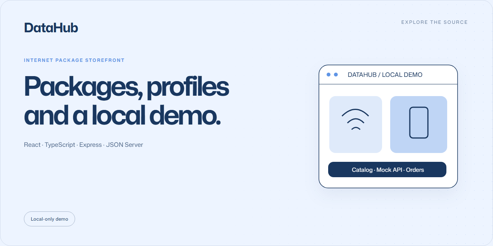

# DataHub

A local internet-package storefront demo with a catalog, customer dashboard and simulated orders.

**React · TypeScript · Express · JSON Server** · Local-only demo

## Demo features

- Browse internet packages and promotions.
- Explore demo sign-in and customer-profile screens.
- Simulate top-ups, orders and transaction history.

## Run locally

Use **Node.js 24**. The application lives in the nested <code>ecommerce-datahub/</code> directory.

```sh
git clone https://github.com/EGYYFZA/ecommerce-datahub.git
cd ecommerce-datahub/ecommerce-datahub
npm ci
npm run dev
```

Open **http://127.0.0.1:3000**. Run the checks from that same nested directory:

```sh
npm run lint
npm run build
node --test tests/query-parser.test.cjs
```

## Local-only boundary

The JSON API has no server-side authentication or authorization. Demo credentials,
balances and orders are not real accounts, funds or transactions. Do not enter
real passwords or personal information, or expose the API through a tunnel,
reverse proxy or public deployment. Loopback binding is not authentication.

Production use would require verified sessions, per-user authorization, password
hashing and server-controlled payments/balances. Keep API secrets out of Vite
configuration. Read [SECURITY.md](SECURITY.md).
